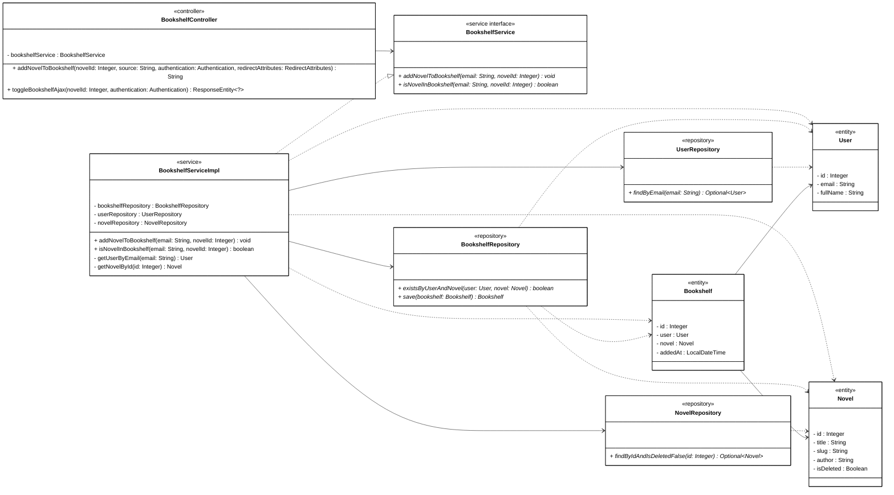

# Mermaid Class Diagram Generation Skill (Spring Boot Context)

This skill provides comprehensive instructions, architectural guidelines, Draw.io compatibility rules, and concrete examples for creating and refactoring Mermaid class diagrams. It ensures diagrams accurately reflect the Spring Boot source code, form a single connected graph with zero orphan classes, and import cleanly into **Draw.io** (`Arrange -> Insert -> Advanced -> Mermaid`) without text overlap.

> [!IMPORTANT]
> **Output Location, Naming Convention & File Encoding**
> - Save all generated Mermaid class diagrams in `docs/diagrams/class_mermaid/`.
> - Follow the naming format `cls_mm_ucXX_use_case_name.mmd` (e.g., `cls_mm_uc06_view_novel_list.mmd`, `cls_mm_uc26_unlock_paid_chapter.mmd`).
> - Always save `.mmd` files as **UTF-8 without BOM** (a UTF-8 BOM at byte 0 can break Mermaid parsers on line 1).

---

## 1. General Participants & Scoping Rules

1. **Strict Use Case Scoping & Core Flow Compacting**:
   - Only include the `Controller`, `Service`, `ServiceImpl`, `Repository`, `DTO`, `Entity`, and helper/policy classes that belong to the **core business flow** of the target Use Case.
   - Do **NOT** mix controllers or services that belong to another Use Case or another module owner.
   - Omit auxiliary/sidebar classes that only serve secondary UI widgets (e.g., sidebar `UserProfileDTO`, top-up suggestion `CoinPackageService` in chapter reading, or cross-module `RatingService`/`CommentService` in novel details) so the Class Diagram and Sequence Diagram remain compact and focused.
2. **Included Stereotypes**:
   - **MVC Controller (`@Controller`)**: `<<controller>>`
   - **REST Controller (`@RestController`)**: `<<rest controller>>`
   - **Service Interface**: `<<service interface>>`
   - **Service Implementation (`@Service`) / Utility Component (`@Component`)**: `<<service>>`
   - **Repository (`@Repository`)**: `<<repository>>`
   - **Data Transfer Object**: `<<dto>>`
   - **Domain Entity (`@Entity`)**: `<<entity>>`
   - **Enum**: `<<enumeration>>`
3. **Excluded Types**:
   - Exclude framework-native, library, or Java built-in classes (`List`, `Set`, `Map`, `Optional`, `Page`, `Pageable`, `String`, `Authentication`, `HttpServletRequest`, `Model`, `RedirectAttributes`, `ResponseEntity`, `BindingResult`, `JpaRepository`).

---

## 2. Draw.io Compatibility & Anti-Overlap Rules (CRITICAL)

When importing Mermaid `classDiagram` code into **Draw.io** (`Arrange -> Insert -> Advanced -> Mermaid`), Draw.io renders a 2-line header (`«stereotype»` on line 1, **ClassName** on line 2, total height `~50px`), but places the first two attribute rows at `y = 26px` and `y = 44px` inside the header area.

To guarantee **2-line stereotype headers (`«controller»` above `ClassName`) with ZERO text overlap in Draw.io**:

1. **Keep `<<stereotype>>` Inside the Class Block**:
   - Always write `<<stereotype>>` inside `{ ... }`.
   - **NEVER** use single-line label aliases like `class HomeController["<<controller>> HomeController"]` (which forces the stereotype and class name onto a single line).
2. **Insert 2 Invisible Braille Blank Spacer Lines (`U+2800`) Immediately After `<<stereotype>>`**:
   - Right below `<<stereotype>>` in **every class**, insert two lines containing Unicode Braille Pattern Blank (`U+2800`):
     - Line 1 after stereotype: `⠀` (one `U+2800` character)
     - Line 2 after stereotype: `⠀⠀` (two `U+2800` characters)
   - Because `U+2800` is not stripped by JavaScript `.trim()` and contains no parentheses, Mermaid parses those two lines as invisible attribute rows 1 and 2 (`y = 26px` and `y = 44px`), automatically pushing the first real attribute (`- field : Type`) down to row 3 (`y = 62px`), cleanly below the header divider line in Draw.io!
3. **Compact Class Compartments (No Getters/Setters or Constructors)**:
   - **`<<dto>>` and `<<entity>>` classes**: Include only private attributes (`- field : Type`) relevant to the Use Case. **Omit** verbose `get...()` and `set...()` methods to keep class boxes compact (60–70% shorter) and readable.
   - **`<<controller>>` and `<<service>>` implementation classes**: Include only their private injected fields and the business methods invoked in the Use Case. **Omit** constructor declarations (`+ ClassName(...)`) and unused/legacy methods.
   - **`<<service interface>>` and `<<repository>>` interfaces**: Mark abstract methods by placing an asterisk (`*`) at the **very end** of the method signature (`+ methodName(param: Type) ReturnType*`).

---

## 3. Allowed Relationships (3 Core Types Only — No Diamonds)

> [!IMPORTANT]
> - **Do NOT use Aggregation (`o--`) or Composition (`*--`) diamonds.** Always use **Unidirectional Association (`-->`)** instead.
> - **No Multiplicity / Cardinality Labels** and **No Relationship Text Labels**.

Use only the following **3 core relationship types** (plus `--|>` inheritance only if a custom superclass is drawn):

| Relationship Type | Mermaid Syntax | When to Use |
| :--- | :---: | :--- |
| **1. Realization (Implementation)** | `..\|>` | A `ServiceImpl` class implements its `Service` interface (`HomeServiceImpl ..\|> HomeService`). |
| **2. Unidirectional Association** | `-->` | Class A **declares a field/attribute** of type Class B (or `List~B~` / `Set~B~`): - Dependency injection (`HomeController --> HomeService`, `HomeServiceImpl --> NovelRepository`) - Entity-to-Entity foreign key / reference field (`Chapter --> Novel`, `Bookshelf --> User`, `Bookshelf --> Novel`, `UserChapterActivity --> User`, `UserChapterActivity --> Chapter`) - DTO-to-DTO nested field (`HomePageDTO --> NovelSummaryDTO`, `BookshelfPageDTO --> BookshelfItemDTO`) |
| **3. Dependency** | `..>` | Class A **does NOT store Class B as a field**, but accepts, returns, queries, or instantiates Class B inside its methods: - Controller using DTO/Entity (`HomeController ..> HomePageDTO`) - Service interface & ServiceImpl using DTO/Entity (`HomeService ..> HomePageDTO`, `HomeServiceImpl ..> Novel`, `HomeServiceImpl ..> Chapter`) - Repository returning/accepting Entity (`NovelRepository ..> Novel`, `ChapterRepository ..> Chapter`, `BookshelfRepository ..> Bookshelf`, `BookshelfRepository ..> User`, `BookshelfRepository ..> Novel`) |

---

## 4. Zero Orphan Classes & Single Connected Graph Rule

Every Mermaid class diagram MUST form **one single connected graph** with **0 orphan classes** and **0 isolated Entity islands**:
- Never leave `Entity` classes (`Novel`, `Chapter`, `User`, `Bookshelf`, `UserChapterActivity`, `UserDailyCheckin`) connected only to each other without linking them to the `Repository` and `ServiceImpl` layers.
- Always declare:
  - `Repository ..> Entity` for every Entity type used in that Repository's methods.
  - `ServiceImpl ..> Entity` and `ServiceImpl ..> DTO` for every Entity/DTO manipulated by that ServiceImpl.
  - `Service ..> DTO` / `Service ..> Entity` for every DTO/Entity in the Service interface's method signatures.
  - `Controller ..> DTO` / `Controller ..> Entity` for every DTO/Entity handled by the Controller.

---

## 5. Complete Reference Example

