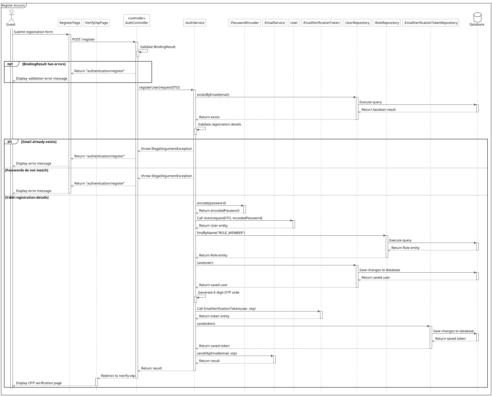
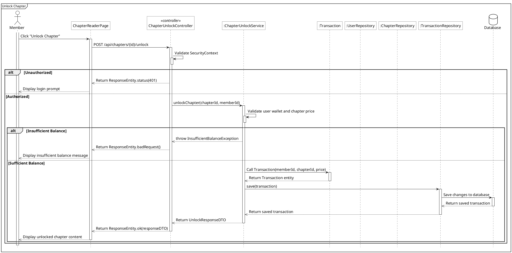

# PlantUML Sequence Diagram Generation Skill (Spring Boot Context)

This skill provides comprehensive instructions, architectural guidelines, styling rules, and concrete reference examples for creating and refactoring PlantUML sequence diagrams. It ensures diagrams are technically accurate, visually consistent, and adhere to strict standards representing runtime interactions (view mediation, lifeline activation, database persistence, return paths, message conciseness, and validation flows) in a Spring Boot MVC/API architecture.

---

## 1. File Naming Convention and Directory

All sequence diagram files must follow the `sq_use_case_name.plantuml` naming convention.
- Prefix: `sq_`
- Use case name: lower snake_case (e.g., `register_account`, `create_novel`, `unlock_chapter`)
- Extension: `.plantuml`
- File location: `plantuml/sequence/` (or `docs/diagrams/sequence_plantuml/`)
- Example: `plantuml/sequence/sq_register_account.plantuml`

---

## 2. Participant Naming and Aliasing

To keep diagrams readable and consistent, participants should be defined at the top with standardized aliases.

### Standardized Primary Actors
Do not invent custom actor names (like "Learner", "Customer", or "Reader"). Use one of the following exact standardized actors as the `act` participant depending on the use case context:
- `Guest` (Unauthenticated visitor)
- `Member` (Authenticated user / novel reader / author)
- `Staff` (Authorized content moderator / editor)
- `Admin` (Highest authority system administrator)

### Standardized Participant Aliases
| Participant Type | PlantUML Definition Example | Alias | Role |
|---|---|---|---|
| Actor | `actor Member as act` | `act` | Human actor interacting with the system |
| View / UI | `participant "RegisterPage" as view` | `view` | Primary UI / Thymeleaf view or frontend page |
| Redirect Target | `participant "LoginPage" as r_view` | `r_view` | Target view rendered after HTTP redirection |
| Controller | `participant "AuthController" as ctrl <<controller>>` | `ctrl` | Spring MVC `@Controller` or `@RestController` |
| Service | `participant ":AuthService" as svc` | `svc` | Spring `@Service` business logic interface |
| Auxiliary Service | `participant ":EmailService" as email_svc` | `email_svc` | Secondary / helper service |
| Security / Encoder | `participant ":PasswordEncoder" as encoder` | `encoder` | Spring Security component (e.g., BCrypt encoder) |
| Entity / DTO | `participant ":User" as ett` | `ett` (or `dto`) | Domain entity or Data Transfer Object |
| Repository | `participant ":UserRepository" as repo` | `repo` | Spring Data `@Repository` (JpaRepository) |
| Database | `database Database as db` | `db` | Physical database storage (cylinder) |

### Modeling Rules
- **Controller Stereotype:** Mark controllers with `<<controller>>` stereotype in their declaration.
- **Interfaces Only for Injected Dependencies:** Always model the interfaces for injected dependencies, not their implementation classes. Prefix class instances with a colon (e.g., `:AuthService` instead of `:AuthServiceImpl`, `:UserRepository` instead of `:UserRepositoryImpl`).
- **Instance Prefixing:** Prefix class instances with a colon (e.g., `:AuthService`, `:NovelRepository`, `:User`). Do not prefix views, controllers, or actor aliases.
- **Visuals:** All participants except actors (stick figure) and databases (cylinder figure) must be drawn as rectangles.
- **Participant Grouping Order:** Declare participants logically in the order of invocation across the architectural layers:
  `act` -> `view` -> `r_view` -> `ctrl` -> `svc` -> (helper services / security) -> `ett` / `dto` -> `repo` -> `db`.
- **Generic Wrapper Stripping:** Do not include framework wrappers like `ResponseEntity<T>`, `Optional<T>`, `Page<T>`, or `List<T>` as participants. Declare participants as the inner domain entity or DTO type (e.g., `participant ":NovelResponseDTO" as dto`).

---

## 3. Style Definitions and Canvas Settings

Every `.plantuml` file must start with standard styling and settings for a clean, cohesive black-and-white look. Copy and paste the following header configuration exactly:

```plantuml
@startuml
<style>
    sequenceDiagram{
        FontSize 16

        arrow {
            ' Set the maximum width of the text on arrows
            MaximumWidth 300
        }
        actor{
            BackgroundColor white
            LineThickness 1.0
        }
        participant{
            BackgroundColor white
            RoundCorner 0
        }
        database{
            BackgroundColor white
        }
        groupHeader{
            BackgroundColor white
        }
        referenceHeader{
            BackgroundColor white
        }
        reference{
            BackgroundColor white
        }
    }
</style>

hide footbox
```

Use `mainframe <Title>` (e.g., `mainframe Register Account`) right after the header, followed by the participant declarations.

---

## 4. Interaction Arrow Styles

Ensure correct arrow types to model request/response control flow:
- `->` (Solid Arrow): Synchronous calls, requests, or internal method invocation.
- `-->>` (Dashed Arrow): Returns, responses, redirects, thrown exceptions, or UI display messages to the actor.

---

## 5. Lifeline Activation and Deactivation

Correctly managing activation (`++`) and deactivation (`--`) is critical to depict when an object is executing, waiting, or completing its lifecycle.

### General Rules
1. **Actor Activation (`++`):** Always activate the actor's lifeline as the first statement in the diagram: `act ++` before any interactions.
2. **Initial Call Activation (`++`):** Append `++` to the receiving participant when it receives its first call (e.g., `view -> ctrl++: POST /register`).
3. **Return Deactivation (`--`):** Deactivate a participant's lifeline when it returns control or throws an exception.
4. **Nested Return Order:** When multiple nested lifelines return in sequence (e.g., `db` to `repo`, then `repo` to `svc`), explicitly deactivate the inner lifeline *before* the outer lifeline makes its return call to its caller:
   ```plantuml
   db -->> repo: Return data
   db--
   repo -->> svc: Return data
   repo--
   ```
5. **Completeness:** Every participant's lifeline (excluding the actor) must be fully deactivated by the time each execution flow reaches its terminus.

---

### Strict View Mediation (No Direct Controller Interaction from Actor)

> [!IMPORTANT]
> In web applications, the human actor (`act`) **never communicates directly with a controller (`ctrl`)**. All actor interactions must pass through a View/UI participant (`view`), which maintains an unbroken activation lifeline during user interaction and server response processing.

1. **Initial Page Navigation (GET Requests):**
   When the actor accesses a page or form, the interaction begins at the View:
   ```plantuml
   act -> view++: Access Register page
   view -> ctrl++: GET /register
   ```
2. **User Actions and Form Submissions (POST / PUT / DELETE Requests):**
   When the actor clicks a button or submits data, the action originates on the active View:
   ```plantuml
   act -> view++: Submit registration form
   view -> ctrl++: POST /register
   ```
3. **Controller Response to View:**
   The controller always returns its view name, redirect, or response entity to the `view`:
   ```plantuml
   ctrl -->> view: Return "authentication/register"
   ```
4. **View Presentation to Actor:**
   The view then presents the result to the actor:
   ```plantuml
   view -->> act: Display error message
   ```
5. **Deactivating the View Lifeline:**
   At the end of an execution path or upon terminal display to the actor, deactivate the view:
   ```plantuml
   view -->> act--: Display success message
   ```
   (Alternatively, place `view--` on the line immediately following `view -->> act`).
6. **Automatic Redirections (`r_view`):**
   When a controller returns a redirect response (e.g., `Return "redirect:/verify-otp"` or `Return "redirect:/login"`):
   - The controller sends the redirect response to the target view (`r_view`) with `--` deactivation.
   - The target view is immediately activated.
   - The target view renders the new page for the actor and deactivates.
   ```plantuml
   ctrl -->> r_view--: Redirect to /verify-otp
   activate r_view
   r_view -->> act--: Display OTP verification page
   ```

---

### Self-Call Activations & Mandatory Conditional Triggers

> [!IMPORTANT]
> An `alt` or `opt` conditional block **must NEVER open without an explicit self-call trigger evaluating the condition beforehand** (the only exception being direct database query result branching right after a database execution call).
> This rule strictly applies to **every single `opt` block** as well as `alt` blocks. An `opt` fragment represents a conditional execution path; therefore, the evaluating participant (controller, service, external auth server, etc.) must evaluate and check the condition via a self-call before entering the `opt` block.

Whenever a controller, service, or external participant evaluates a condition, checks data, or validates input:
1. **Model the self-call:** Call the evaluating participant: `participant -> participant++: [Semantic condition/validation check]`.
2. **Immediately deactivate:** Deactivate on the very next line: `participant--`.
3. **Open the conditional fragment:** Open `alt` or `opt` on the subsequent line.

#### Patterns of Self-Call Triggers for `opt` Blocks:
- **Spring Bean Validation (`BindingResult` / `@Valid`):**
  ```plantuml
  ctrl -> ctrl++: Validate BindingResult
  ctrl--
  opt BindingResult has errors
      ctrl -->> view: Return "authentication/register"
      view -->> act: Display validation error message
  end
  ```
- **External OAuth2 / User Authorization Decisions (Google OAuth2, SSO):**
  When evaluating user consent or external provider response before an alternative cancellation/denial branch:
  ```plantuml
  google -> google++: Validate authorization decision
  google--
  opt Authorization denied by user
      act -> google: Deny authorization
      google -->> sec: Callback /login/oauth2/code/google (error=access_denied)
      sec -> failure_handler++: onAuthenticationFailure(request, response, exception)
      failure_handler -->> sec--: Return result
      sec -->> view: Redirect to /login?error
      activate view
      view -->> act: Display login cancelled message
      deactivate view
  end
  ```
- **Optional Feature / Pre-condition Check:**
  ```plantuml
  svc -> svc++: Check coupon eligibility
  svc--
  opt Coupon is valid
      svc -> svc++: Apply discount to order
      svc--
  end
  ```

#### Patterns of Self-Call Triggers for `alt` Blocks:
- **Service-Level Business Logic Checks:**
  When a service checks uniqueness, state, password matching, or business rules after querying data:
  ```plantuml
  svc -> repo++: existsByEmail(email)
  repo -> db++: Execute query
  db -->> repo: Return exists
  db--
  repo -->> svc: Return exists
  repo--

  svc -> svc++: Check email availability
  svc--
  alt Email already exists
      svc -->> ctrl: throw DuplicateEmailException
      ctrl -->> view: Return "authentication/register"
      view -->> act: Display error message
  else Email available
  ```
- **Semantic Triggers for Flat Structures (Collapsing Multiple Validations):**
  When multiple related validation checks occur consecutively in a service (e.g., checking email uniqueness followed by password matching), do not create deep staircases of nested alts. Collapse them into a single high-level semantic trigger:
  ```plantuml
  svc -> svc++: Validate registration details
  svc--
  alt Email already exists
      svc -->> ctrl: throw IllegalArgumentException
      ctrl -->> view: Return "authentication/register"
      view -->> act: Display error message
  else Passwords do not match
      svc -->> ctrl: throw IllegalArgumentException
      ctrl -->> view: Return "authentication/register"
      view -->> act: Display error message
  else Valid registration details
      ' Proceed to success execution flow
  ```
- **Auxiliary Helper Self-Calls:**
  For minor internal helper logic that does not branch (e.g., token generation, OTP formatting, mapping entities):
  ```plantuml
  svc -> svc++: Generate 6-digit OTP code
  svc--
  ```

---

### Trailing Lifeline Deactivation in Alt Blocks

When a diagram uses a fail-fast flat `alt` structure, long-running trailing lifelines (`svc`, `ctrl`, `view`, `act`) are **not** deactivated (`--`) in early failure/exception branches.
- They must be trailed entirely down the diagram and deactivated **only in the final branch visually rendered at the bottom of the outermost `alt`** (which is usually the success branch).
- At the very end of the diagram, ensure the final active view participant is fully deactivated when it returns control or displays the final message to the actor: `view -->> act--: Display success message`.

> [!NOTE]
> **Special Rule: When the Success Path Redirects to `r_view` (Not `view`):**
> If the final/success branch redirects to a target view (`r_view`) instead of returning to the origin `view`, `view` does not participate in that final branch at all. In this scenario, `view` must be deactivated at the **last branch where it displays a response to the actor** (e.g., `view -->> act--: Display error message` at the end of the last error branch returning to `view`). This terminates `view`'s activation box right where its lifecycle ends, preventing it from leaking down through backend operations and the subsequent redirection to `r_view`.

---

## 6. Flow Logic Guidelines

### Mapping Use Case to Diagram
- **Alternative flows** must be modeled as `opt` fragments.
- **Exceptions** must be modeled as `alt` fragments.
- **Mandatory Preceding Self-Call for `opt` Blocks:** Every `opt` fragment representing an alternative flow or optional validation MUST be preceded by an explicitly activated and immediately deactivated self-call trigger (`participant -> participant++: ...` followed by `participant--`). Never open an `opt` fragment directly without an evaluation trigger.
- **Omit Trivial UI-Only Interactions:** Do not model purely client-side trivial UI interactions (like closing a modal, toggling a dropdown, or canceling a form) as `opt` blocks unless they involve a request to the backend or represent a significant validation barrier.

---

### Strict Message Granularity and Conciseness Guidelines

> [!CAUTION]
> Sequence diagrams model system interactions, not raw source code dumps. Messages on arrows must be concise, semantic, and high-level. Avoid the following anti-patterns:

#### 1. FORBIDDEN: Raw SQL Queries
- **Never** write raw SQL statements (`SELECT ...`, `INSERT ...`, `UPDATE ...`, `DELETE ...`) on database interaction arrows.
- Repository-to-Database calls must use high-level semantic descriptions:
  - Read query: `repo -> db++: Execute query`
  - Write / Save: `repo -> db++: Save changes to database`
- Database returns must be high-level:
  - Read return: `db -->> repo: Return data` (or `Return boolean result`, `Return entity`)
  - Write return: `db -->> repo: Return numberOfRowsAffected` (or `Return saved entity`)

#### 2. FORBIDDEN: Fluent Method Chaining, Builders, and Multi-line Attribute Lists
- **Never** model Lombok builder chains or multi-line attribute setters:
  - *Wrong:* `svc -> ett++: User.builder().email(email).password(pass)\n.status("PENDING").build()`
- Model instantiation as a clean constructor call to the entity/DTO participant:
  - *Correct:* `svc -> ett++: Call User(registerDTO, encodedPassword)`
  - *Return:* `ett -->> svc--: Return User entity`

#### 3. FORBIDDEN: Exception Message Arguments and Localized Strings
- **Never** pass message strings or localized text inside throw statements:
  - *Wrong:* `svc -->> ctrl: Throw IllegalArgumentException("Email đã được sử dụng")`
  - *Correct:* `svc -->> ctrl: throw IllegalArgumentException` (or specific domain exception like `throw DuplicateEmailException`)

#### 4. FORBIDDEN: Internal Framework Plumbing / Boilerplate Calls
- **Never** model framework internal calls such as `model.addAttribute(...)`, `redirectAttributes.addFlashAttribute(...)`, `session.setAttribute(...)`, or `bindingResult.hasErrors()`.
- The sequence diagram models domain interactions, not internal framework map modifications.
- The controller simply returns the view name or redirect URL:
  - *Correct:* `ctrl -->> view: Return "authentication/register"`
  - *Correct:* `ctrl -->> r_view: Redirect to /verify-otp`

#### 5. FORBIDDEN: Field Enumeration in Actor Actions
- **Never** dump every form field name into the actor's action message:
  - *Wrong:* `act -> view++: Enter registration details (fullName, email, password, confirmPassword) & submit`
  - *Correct:* `act -> view++: Submit registration form` or `act -> view++: Click "Register"`

#### 6. FORBIDDEN: `void` Literals on Return Arrows
- **Never** write `void` on a return arrow:
  - *Wrong:* `svc -->> ctrl: void` or `user -->> svc--: void`
- Standardize all void method completions as `Return result`:
  - *Correct:* `svc -->> ctrl--: Return result`
  - *Correct:* `email_svc -->> svc--: Return result`

#### 7. Standardized Controller Return Messages
- **Thymeleaf MVC Views:** `Return "viewName"` (e.g., `Return "authentication/register"`).
- **Redirection:** `fe_ctrl -->> r_view: Redirect to /target-url` (omit verbose query parameter concatenations).
- **REST APIs:** `Return ResponseEntity.ok(...)` or `Return ResponseEntity.badRequest(...)` (omit verbose JSON payload dumps).

#### 8. Standardized UI Feedback Descriptions
- Avoid exact UI copy or toast widget implementation details.
- Use generic interaction descriptions:
  - `Display error message`
  - `Display validation error message`
  - `Display success message`
  - `Display registration form`

---

### Diagram Complexity and Ref Fragments
To prevent sequence diagrams from becoming overwhelmingly cluttered, large multi-step execution flows or sub-processes must be extracted into their own separate sequence diagrams and referenced using `ref over`.
- **User Approval Required:** Before extracting logic into a `ref` fragment, explicitly propose the extraction and the new diagram filename to the user and obtain approval.
- **Background Tasks & Concurrency (`par` fragment):**
  When asynchronous or background tasks are executed concurrently (e.g., sending verification emails via Spring `@Async` / `TaskExecutor`):
  - Model parallel execution with `par`.
  - Place background tasks in the first branch(es).
  - Place the main thread synchronous return path as the final `else` branch before `end`.
  ```plantuml
  par Send Verification Email (Async)
      svc -> email_svc++: sendOtpEmail(email, otp)
      email_svc -->> svc--: Return result
  else Main Thread Return
      svc -->> ctrl--: Return result
      ctrl -->> r_view--: Redirect to /verify-otp
      activate r_view
      r_view -->> act--: Display OTP verification page
  end
  ```

---

### Database Operations (Spring Data JPA)
- Use semantic repository method names (e.g., `findByEmail`, `existsByEmail`, `save`, `delete`).
- The repository interacts with the database:
  - `repo -> db++: Execute query` (read)
  - `repo -> db++: Save changes to database` (write)
- Database failure paths:
  - Read: Branch on data presence (`alt Entity not found` vs `else Entity found`) right after the query return.
  - Write: Catch Spring's `DataAccessException` or domain exception (`alt Database Save Failure` vs `else Database Save Success`), or branch on `numberOfRowsAffected`.
- **Transactions:** Omit raw transaction boundaries (`@Transactional`, `Begin`, `Commit`, `Rollback`) to minimize clutter.

---

## 7. Cross-Diagram Synchronization

When provided with attached class diagrams (in Mermaid, PlantUML, etc.) alongside the prompt:
- **Synchronization Check:** Ensure that every participant, class, interface, method, and return type used in the sequence diagram accurately matches the project's class diagrams and Java source code.
- **Handling Missing Elements:** If you need to introduce a new method, class, or dependency that does not exist in the class diagram, explicitly ask the user for confirmation before proceeding.

---

## 8. Verification Checklist and Workflow

Every time you generate, validate, refactor, or edit a sequence diagram, strictly evaluate each item in this checklist:

### 1. File and Participants
- [ ] **File Naming:** Does the file follow `sq_use_case_name.plantuml` in `plantuml/sequence/`?
- [ ] **Primary Actor:** Is the actor exactly one of `Guest`, `Member`, `Staff`, or `Admin`?
- [ ] **Participant Aliases:** Are aliases standardized (`act`, `view`, `r_view`, `ctrl`, `svc`, `ett`/`dto`, `repo`, `db`)?
- [ ] **Interfaces Only:** Are injected dependencies modeled as interfaces (e.g., `:AuthService`, `:UserRepository`)?
- [ ] **Instance Prefixing:** Are class instances prefixed with a colon (`:`)?
- [ ] **Participant Grouping:** Are participants declared in logical architectural order?
- [ ] **Wrapper Filtering:** Are generic wrappers like `ResponseEntity` and `Optional` omitted as participants in favor of the inner domain type?

### 2. Canvas and Styling
- [ ] **Style Block:** Is the complete standard `<style>` block included?
- [ ] **Footbox & Mainframe:** Are `hide footbox` and `mainframe <Title>` present?
- [ ] **Arrows:** Are synchronous requests using `->` and returns/responses/exceptions using `-->>`?

### 3. View Mediation and Lifelines
- [ ] **Strict View Mediation:** Does EVERY actor interaction start through the view (`act -> view++: ...` followed by `view -> ctrl++: ...`)? Is direct communication from `act` to `ctrl` strictly avoided?
- [ ] **Actor Lifeline:** Is `act ++` present at the very top?
- [ ] **Initial Call:** Are lifelines activated on their first incoming call (`++`)?
- [ ] **Nested Returns:** Are inner lifelines deactivated *before* outer lifelines make their return call (e.g., `db--` before `repo -->> svc`)?
- [ ] **Trailing Lifelines:** In flat structures, are trailing lifelines deactivated only in the final branch at the bottom of the outermost `alt`?
- [ ] **Final Actor Return:** Is the final view deactivated upon displaying the terminal message to the actor (`view -->> act--: Display ...`)?
- [ ] **Redirect Targets:** Are redirects modeled using `ctrl -->> r_view--: Redirect to ...` followed by `activate r_view` and `r_view -->> act--: Display ...`?

### 4. Self-Calls and Conditional Triggers
- [ ] **Mandatory Trigger for `alt` and `opt`:** Is EVERY `alt` block AND EVERY `opt` block preceded by an explicitly activated and immediately deactivated self-call trigger (`participant -> participant++: ...`, `participant--`)?
- [ ] **Pre-`opt` Evaluation:** Does every `opt` block have a clear evaluating participant performing a self-call right before entering the `opt` fragment (e.g., `ctrl -> ctrl++: Validate BindingResult` or `google -> google++: Validate authorization decision`)?
- [ ] **Semantic Triggers:** Are multiple internal validations collapsed into a single high-level semantic trigger before a flat `alt`?
- [ ] **Auxiliary Helpers:** Are helper self-calls (e.g., OTP generation, encoding) activated and instantly deactivated?

### 5. Message Conciseness and Specificity (Anti-Pattern Check)
- [ ] **No Raw SQL:** Are raw SQL queries (`SELECT`, `INSERT`, `UPDATE`, `DELETE`) completely absent? Are semantic messages (`Execute query`, `Save changes to database`) used instead?
- [ ] **No Builders / Chaining:** Are multi-line builder patterns and method chains omitted in favor of concise `Call ClassName(args)`?
- [ ] **No Exception Strings:** Are exception throw messages free of string literals and localized parameters (e.g., `throw IllegalArgumentException`)?
- [ ] **No Framework Boilerplate:** Are internal calls like `model.addAttribute(...)` and `redirectAttributes.addFlashAttribute(...)` omitted?
- [ ] **No Field Enumeration:** Are actor actions concise (e.g., `Submit registration form`) without enumerating individual input fields?
- [ ] **No `void` Literals:** Are void returns strictly modeled as `Return result`?
- [ ] **Concise Controller Returns:** Are returns concise (`Return "viewName"`, `Redirect to /url`, `Return ResponseEntity.ok()`) without dumping long strings or JSON?
- [ ] **Generic UI Feedback:** Are display messages generic (e.g., `Display error message`, `Display success message`)?

---

## 9. Reference Templates

### Reference 1: Spring Boot MVC (Thymeleaf) Account Registration
The following diagram demonstrates standard view mediation, security/validation triggers, concise database messaging, and proper activation lifelines:



### Reference 2: Spring Boot REST API Use Case
For a REST API use case (e.g., Chapter Unlock via API), the client-side view interacts with a `@RestController`:


